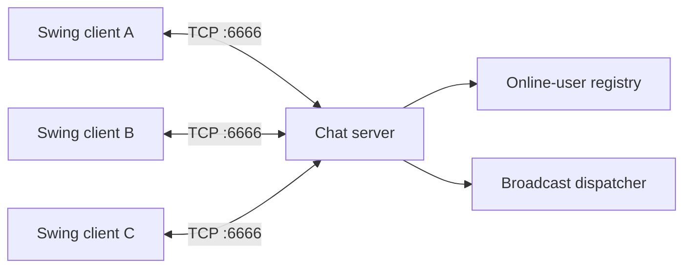

# Java SE Application Portfolio

**English** | [简体中文](README.zh-CN.md)

[](https://openjdk.org/projects/jdk/21/)
[](.github/workflows/java-ci.yml)
[](LICENSE)
[](README.md)

A Java 21 portfolio built around two application-focused learning tracks: Java SE foundations and advanced Java. Together they contain 202 Java source files covering desktop development, object-oriented design, collections, Stream processing, file I/O, concurrency, networking, reflection, annotations, dynamic proxies, and JUnit.

The repository emphasizes working software. Three applications provide the clearest review path: a multi-client TCP chat system, a Swing employee management interface, and a Swing sliding-tile game.

## Technical Highlights

| Area | Demonstrated by |
| --- | --- |
| Desktop engineering | Swing layouts, custom dialogs, menus, keyboard input, table models, event handling, and image-driven rendering |
| Network programming | TCP client/server communication, framed messages, online-user synchronization, and broadcast delivery |
| Concurrency | Worker threads, shared state, synchronization, locks, thread pools, `Callable`, and `Future` |
| Object-oriented design | Encapsulation, inheritance, abstraction, interfaces, polymorphism, composition, and enums |
| Core Java data APIs | Collections, generics, Map traversal, Lambda expressions, Stream pipelines, and summary statistics |
| I/O and persistence | Byte streams, character streams, file traversal, object serialization, and Apache Commons IO |
| Advanced Java | Reflection, custom annotations, dynamic proxies, and JUnit 5 test structure |
| Engineering workflow | IntelliJ modules, dependency manifest, GitHub Actions compilation, issue/PR templates, and security policy |

## Featured Applications

### LAN Chat System

Locations: [`itheima-chat-system`](java-rumeng/javaseprojectaimax/itheima-chat-system) and [`ithiema-chat-server`](java-rumeng/javaseprojectaimax/ithiema-chat-server)

Main classes:

- Client: `ui.App`
- Server: `server.Server`

Implementation details:

- Swing nickname entry and chat workspace.
- Multi-client TCP server with one worker thread per connection.
- Online-user registry and live user-list synchronization.
- Broadcast delivery for every chat message.
- Opcode-first binary protocol using `DataInputStream` and `DataOutputStream`.
- Disconnect detection and online-user cleanup.



The server keeps the accept loop small and delegates protocol handling to `ServerReaderThread`. Messages start with an integer operation code followed by a typed payload, making message boundaries explicit.

### Employee Management System

Location: [`heima-employee-system`](java-rumeng/javaseAIproject/heima-employee-system)

Main class: `UI.App`

Implementation details:

- Custom login window with in-memory demo accounts.
- `JTable` and `DefaultTableModel` for employee records.
- Add and delete operations backed by an in-memory repository.
- Right-click context menu and a dedicated employee form.
- Lombok-based JavaBean definitions.

The application is intentionally self-contained so that event flow, table-model updates, and communication between windows can be studied without a database or web framework.

### Stone Maze

Location: [`stone-maze`](java-rumeng/javaseAIproject/stone-maze)

Main class: `com.itheima.App`

Implementation details:

- A 4 x 4 sliding-tile game represented by a two-dimensional matrix.
- Arrow-key controls with adjacency validation.
- Win-state detection against a target board.
- Move counter and persistent best-score handling.
- Image-backed Swing rendering with restart and exit actions.

The application follows a state-driven rendering cycle: a move updates the matrix, recalculates the board state, and redraws the view from that model.

## Application Tracks

### Java SE Foundations

Location: [`java-rumeng/javaseAIproject`](java-rumeng/javaseAIproject)

The foundation track progresses from language basics to complete desktop applications:

- `day01` to `day03`: Java syntax, operators, selection, loops, and small console programs.
- `day04` to `day06`: encapsulation, inheritance, polymorphism, abstract classes, interfaces, enums, inner classes, lambdas, strings, and Swing fundamentals.
- `heima-employee-system`: a multi-window employee management application.
- `stone-maze`: a complete keyboard-driven puzzle game.

### Advanced Java

Location: [`java-rumeng/javaseprojectaimax`](java-rumeng/javaseprojectaimax)

The advanced track expands into the wider Java SE ecosystem:

- `day09`: collections, exception handling, and generic programming.
- `day10`: sets, maps, collection traversal, and vote-counting exercises.
- `day11`: functional Stream pipelines and a card-game model.
- `day12`: byte-stream and character-stream I/O, recursive file search, and Commons IO.
- `day13`: thread creation, shared-state races, synchronization, and explicit locks.
- `day14`: `ExecutorService`, `Callable`, `Future`, and concurrent task exercises.
- `day15`: TCP, UDP, socket communication, and multi-client server patterns.
- `day16`: annotations, reflection, dynamic proxies, and JUnit 5.
- `itheima-chat-system` and `ithiema-chat-server`: the LAN chat application.

## Technology Stack

| Category | Technology |
| --- | --- |
| Language | Java 21 |
| Desktop UI | Swing, AWT |
| Networking | TCP/IP sockets, UDP datagram sockets |
| Concurrency | `Thread`, `synchronized`, `Lock`, `ExecutorService` |
| Data APIs | Collections, Generics, Stream API, serialization |
| Libraries | Lombok 1.18.42, Apache Commons IO 2.21.0, FlatLaf 3.5.2, JUnit 5.10.5 |
| Tooling | IntelliJ IDEA modules, Maven dependency resolution, Git, GitHub Actions |

## Repository Layout

```text
.
|-- java-rumeng/
|   |-- javaseAIproject/             # Foundations, desktop apps, Swing practice
|   `-- javaseprojectaimax/          # Advanced Java SE and the chat system
|-- .github/                         # CI and collaboration templates
|-- pom.xml                          # Versioned dependency manifest
|-- README.md
|-- README.zh-CN.md
`-- LICENSE
```

The two project directories retain their original IntelliJ module structure. `pom.xml` is a dependency manifest for reproducible CI setup; individual applications are run directly from their main classes.

## Run Locally

### Prerequisites

- JDK 21
- IntelliJ IDEA recommended
- Lombok plugin and annotation processing enabled

Open either project directory directly in IntelliJ IDEA:

- `java-rumeng/javaseAIproject`
- `java-rumeng/javaseprojectaimax`

| Application | Main class | Run note |
| --- | --- | --- |
| Chat server | `server.Server` | Start before any client |
| Chat client | `ui.App` | Start one or more clients |
| Employee system | `UI.App` | Enable Lombok annotation processing |
| Stone Maze | `com.itheima.App` | Working directory: `javaseAIproject` |

### Chat System from PowerShell

Compile both chat modules from the repository root:

```powershell
New-Item -ItemType Directory -Force build\chat | Out-Null
Get-ChildItem `
  java-rumeng\javaseprojectaimax\ithiema-chat-server\src, `
  java-rumeng\javaseprojectaimax\itheima-chat-system\src `
  -Recurse -Filter *.java |
  ForEach-Object FullName |
  Set-Content build\chat-sources.txt

javac -encoding UTF-8 -d build\chat "@build\chat-sources.txt"
```

Start the server in one terminal:

```powershell
java -cp build\chat server.Server
```

Start the client in another terminal:

```powershell
java -cp build\chat ui.App
```

The default server address is `127.0.0.1:6666`. For a LAN demo, update the client host in `ChatEntryFrame` and allow port `6666` through the firewall.

## Verification

The `Java CI` workflow:

- Uses JDK 21.
- Resolves pinned dependencies through Maven.
- Compiles both application tracks as separate source modules.
- Compiles the employee system with Lombok annotation processing.
- Compiles the chat client and server together.
- Runs a representative console example to verify class loading and output.

Maven is used for dependency resolution in CI. The IntelliJ module files remain the primary interactive run configuration.

## Design Notes

- The chat protocol uses explicit operation codes and typed payloads instead of delimiter-based parsing.
- The chat server uses a direct thread-per-client model to make connection lifecycle and broadcast behavior visible.
- The maze applies model-update/redraw cycles instead of mutating individual UI components.
- The advanced track progresses from collection selection to Stream transformations, then to I/O, concurrency, and network communication.
- Reflection, annotations, and dynamic proxies are demonstrated separately from application code so that each mechanism remains readable.

## Known Limitations and Next Steps

This is a learning and portfolio repository, not a production system:

- The employee system stores records in memory; search and edit actions are placeholders.
- Demo authentication is not suitable for real users, and no credentials or environment secrets are required.
- The chat transport is plaintext and intended for trusted local networks.
- The shared chat registry should evolve to `ConcurrentHashMap`, and the thread-per-client model should move to managed executors under higher load.
- Some examples retain course-style naming and Chinese UI text.
- Automated verification focuses on compilation and a console smoke test; protocol and domain-level unit tests are the next priority.

## License

Original code in this repository is released under the [MIT License](LICENSE). Vendored third-party binaries remain under their upstream licenses. See [THIRD_PARTY_NOTICES.md](THIRD_PARTY_NOTICES.md) for details.
