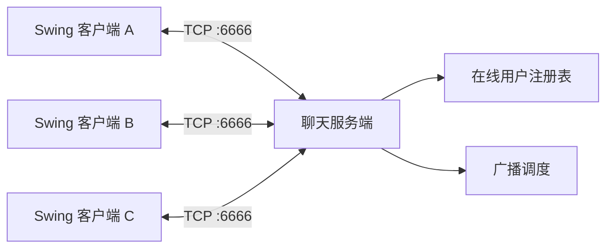

# Java SE 应用作品集

[English](README.md) | **简体中文**

[](https://openjdk.org/projects/jdk/21/)
[](.github/workflows/java-ci.yml)
[](LICENSE)
[](README.zh-CN.md)

这是一个基于 Java 21 的应用型作品集，由“Java SE 基础”与“Java SE 进阶”两条项目线组成。两套工程共包含 202 个 Java 源文件，覆盖桌面开发、面向对象设计、集合、Stream 处理、文件 I/O、并发、网络、反射、注解、动态代理和 JUnit。

仓库强调可以实际运行的软件成果。建议从三个应用开始阅读：多客户端 TCP 聊天室、Swing 员工管理系统和 Swing 数字华容道。

## 技术亮点

| 技术方向 | 代码中的体现 |
| --- | --- |
| 桌面工程 | Swing 布局、自定义对话框、菜单、键盘输入、表格模型、事件处理与图片渲染 |
| 网络编程 | TCP 客户端/服务端通信、消息分帧、在线用户同步和群发广播 |
| 并发编程 | 工作线程、共享状态、同步、锁、线程池、`Callable` 与 `Future` |
| 面向对象 | 封装、继承、抽象、接口、多态、组合和枚举 |
| Java 核心数据 API | 集合、泛型、Map 遍历、Lambda、Stream 流水线和汇总统计 |
| I/O 与持久化 | 字节流、字符流、文件遍历、对象序列化和 Apache Commons IO |
| Java 进阶 | 反射、自定义注解、动态代理和 JUnit 5 测试结构 |
| 工程化 | IntelliJ 模块、依赖清单、GitHub Actions 编译、Issue/PR 模板和安全策略 |

## 核心应用

### 局域网聊天室

位置：[`itheima-chat-system`](java-rumeng/javaseprojectaimax/itheima-chat-system) 与 [`ithiema-chat-server`](java-rumeng/javaseprojectaimax/ithiema-chat-server)

主类：

- 客户端：`ui.App`
- 服务端：`server.Server`

实现要点：

- 基于 Swing 的昵称登录和聊天工作区。
- TCP 服务端支持多个客户端，每个连接由独立工作线程处理。
- 在线用户注册表和实时用户列表同步。
- 每条聊天消息进行群发广播。
- 基于 `DataInputStream` 与 `DataOutputStream` 的操作码消息协议。
- 客户端断开检测和在线用户清理。



服务端把连接接收循环保持在较小规模，将协议处理交给 `ServerReaderThread`。消息以整数操作码开头，随后读取对应类型的负载，消息边界明确。

### 员工管理系统

位置：[`heima-employee-system`](java-rumeng/javaseAIproject/heima-employee-system)

主类：`UI.App`

实现要点：

- 自定义登录窗口和内存演示账号。
- 使用 `JTable` 与 `DefaultTableModel` 展示员工记录。
- 添加、删除员工并同步内存仓库。
- 右键上下文菜单和独立员工表单。
- 使用 Lombok 简化 JavaBean 定义。

该应用保持自包含，便于在没有数据库和 Web 框架的情况下研究事件流转、表格模型更新以及窗口间通信。

### 石头迷宫

位置：[`stone-maze`](java-rumeng/javaseAIproject/stone-maze)

主类：`com.itheima.App`

实现要点：

- 使用二维数组表示 4 x 4 数字华容道。
- 方向键控制并校验相邻位置。
- 根据目标矩阵判断胜利状态。
- 步数统计和历史最佳成绩持久化。
- 图片化 Swing 渲染以及重新开始、退出动作。

应用采用状态驱动渲染：每次移动先更新矩阵，再重新计算棋盘状态，最后从模型状态重绘界面。

## 两条项目线

### Java SE 基础

位置：[`java-rumeng/javaseAIproject`](java-rumeng/javaseAIproject)

基础项目线从语言入门逐步推进到完整桌面应用：

- `day01` 至 `day03`：Java 语法、运算符、选择结构、循环和小型控制台程序。
- `day04` 至 `day06`：封装、继承、多态、抽象类、接口、枚举、内部类、Lambda、字符串和 Swing 基础。
- `heima-employee-system`：多窗口员工管理应用。
- `stone-maze`：完整的键盘驱动拼图游戏。

### Java SE 进阶

位置：[`java-rumeng/javaseprojectaimax`](java-rumeng/javaseprojectaimax)

进阶项目线扩展到更完整的 Java SE 技术面：

- `day09`：集合、异常处理和泛型编程。
- `day10`：Set、Map、集合遍历和投票统计练习。
- `day11`：函数式 Stream 流水线和纸牌游戏模型。
- `day12`：字节流、字符流、递归文件搜索和 Commons IO。
- `day13`：线程创建、共享状态竞争、同步和显式锁。
- `day14`：`ExecutorService`、`Callable`、`Future` 和并发任务练习。
- `day15`：TCP、UDP、Socket 通信和多客户端服务端模式。
- `day16`：注解、反射、动态代理和 JUnit 5。
- `itheima-chat-system` 与 `ithiema-chat-server`：局域网聊天室应用。

## 技术栈

| 分类 | 技术 |
| --- | --- |
| 语言 | Java 21 |
| 桌面 UI | Swing、AWT |
| 网络 | TCP/IP Socket、UDP Datagram Socket |
| 并发 | `Thread`、`synchronized`、`Lock`、`ExecutorService` |
| 数据 API | Collections、Generics、Stream API、序列化 |
| 依赖库 | Lombok 1.18.42、Apache Commons IO 2.21.0、FlatLaf 3.5.2、JUnit 5.10.5 |
| 工具 | IntelliJ IDEA 模块、Maven 依赖解析、Git、GitHub Actions |

## 仓库结构

```text
.
|-- java-rumeng/
|   |-- javaseAIproject/             # Java SE 基础、桌面应用与 Swing 练习
|   `-- javaseprojectaimax/          # Java SE 进阶与聊天室系统
|-- .github/                         # CI 与协作模板
|-- pom.xml                          # 带版本号的依赖清单
|-- README.md
|-- README.zh-CN.md
`-- LICENSE
```

两个项目目录保留原有 IntelliJ 模块结构。`pom.xml` 用于为 CI 提供可复现的依赖清单；具体应用仍通过各自主类运行。

## 本地运行

### 环境要求

- JDK 21
- 推荐使用 IntelliJ IDEA
- 启用 Lombok 插件和注解处理

在 IntelliJ IDEA 中直接打开以下任一项目目录：

- `java-rumeng/javaseAIproject`
- `java-rumeng/javaseprojectaimax`

| 应用 | 主类 | 运行说明 |
| --- | --- | --- |
| 聊天服务端 | `server.Server` | 先于客户端启动 |
| 聊天客户端 | `ui.App` | 可启动多个客户端 |
| 员工管理系统 | `UI.App` | 启用 Lombok 注解处理 |
| 石头迷宫 | `com.itheima.App` | 工作目录设为 `javaseAIproject` |

### 使用 PowerShell 运行聊天室

在仓库根目录编译客户端和服务端：

```powershell
New-Item -ItemType Directory -Force build\chat | Out-Null
Get-ChildItem `
  java-rumeng\javaseprojectaimax\ithiema-chat-server\src, `
  java-rumeng\javaseprojectaimax\itheima-chat-system\src `
  -Recurse -Filter *.java |
  ForEach-Object FullName |
  Set-Content build\chat-sources.txt

javac -encoding UTF-8 -d build\chat "@build\chat-sources.txt"
```

在第一个终端启动服务端：

```powershell
java -cp build\chat server.Server
```

在第二个终端启动客户端：

```powershell
java -cp build\chat ui.App
```

默认服务地址为 `127.0.0.1:6666`。进行局域网演示时，请修改 `ChatEntryFrame` 中的客户端主机地址，并允许防火墙放行 `6666` 端口。

## 验证方式

`Java CI` 工作流会执行以下检查：

- 使用 JDK 21。
- 通过 Maven 解析固定版本的依赖。
- 将两条项目线按独立源码模块编译。
- 使用 Lombok 注解处理编译员工管理系统。
- 将聊天客户端与服务端放在同一次编译中检查交叉依赖。
- 运行一个代表性控制台示例，检查类加载与输出。

Maven 在 CI 中用于依赖解析，IntelliJ 模块文件仍是本地交互运行的主要配置。

## 设计说明

- 聊天协议使用显式操作码和类型化负载，而不是依赖分隔符解析。
- 聊天服务端采用直观的每客户端单线程模型，便于观察连接生命周期和广播行为。
- 迷宫采用模型更新后重绘的循环，而不是直接修改单个界面组件。
- 进阶项目线从集合选择推进到 Stream 转换，再到 I/O、并发和网络通信。
- 反射、注解和动态代理与业务应用分开展示，使每种机制保持可读。

## 当前边界与后续方向

这是一个学习与作品集仓库，而不是生产系统：

- 员工系统使用内存存储，搜索和编辑动作目前是占位实现。
- 演示登录不适合真实用户，项目不要求任何账号、密钥或环境凭据。
- 聊天传输为明文，目标场景是可信任的局域网。
- 在线用户注册表后续应改为 `ConcurrentHashMap`，高负载下应将每连接线程模型升级为受管理的线程池。
- 部分示例保留课堂式命名和中文界面。
- 自动化验证目前以编译和控制台冒烟运行为主，聊天协议与领域层单元测试是下一阶段重点。

## 许可证

本仓库原创代码使用 [MIT License](LICENSE)。随仓库附带的第三方二进制文件继续遵循其上游许可证，详情见 [THIRD_PARTY_NOTICES.md](THIRD_PARTY_NOTICES.md)。
